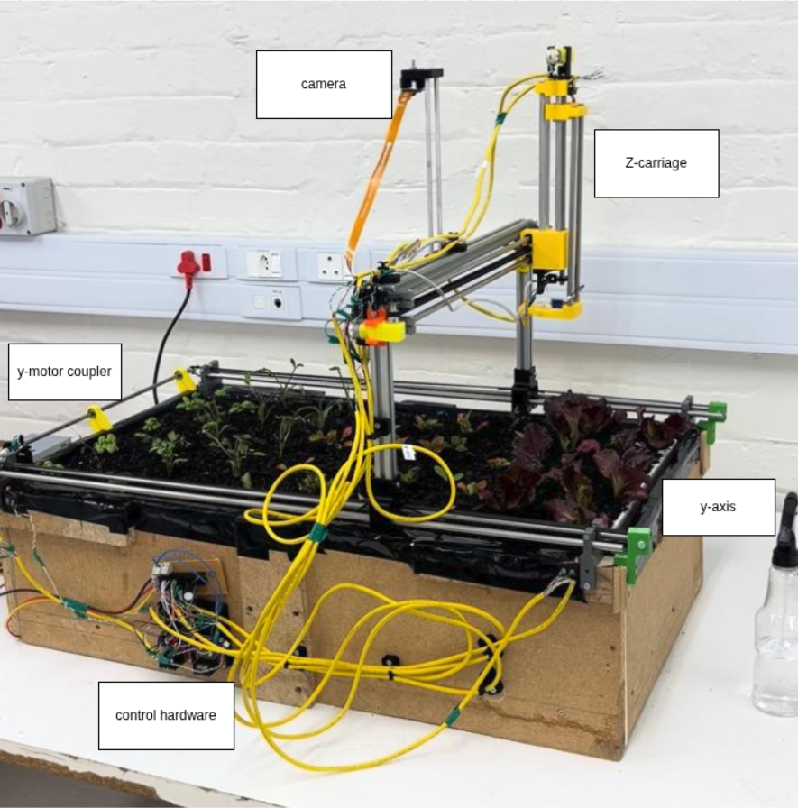
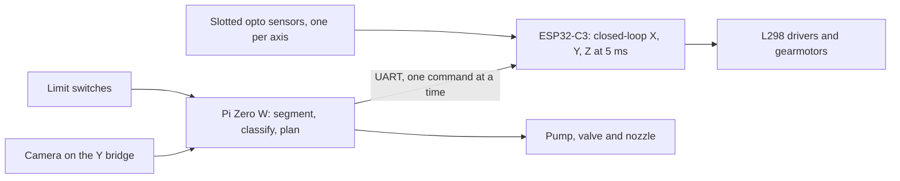
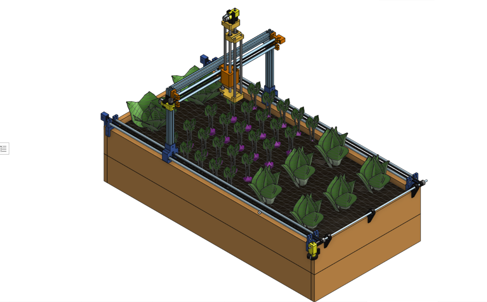
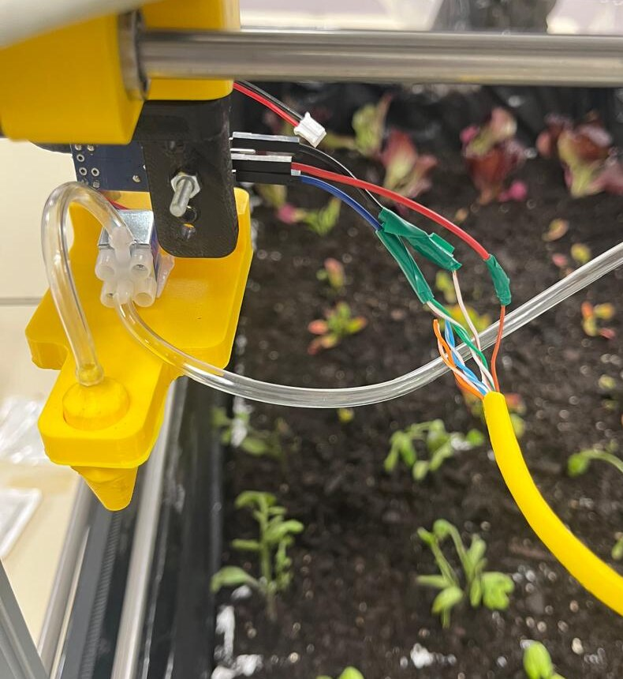
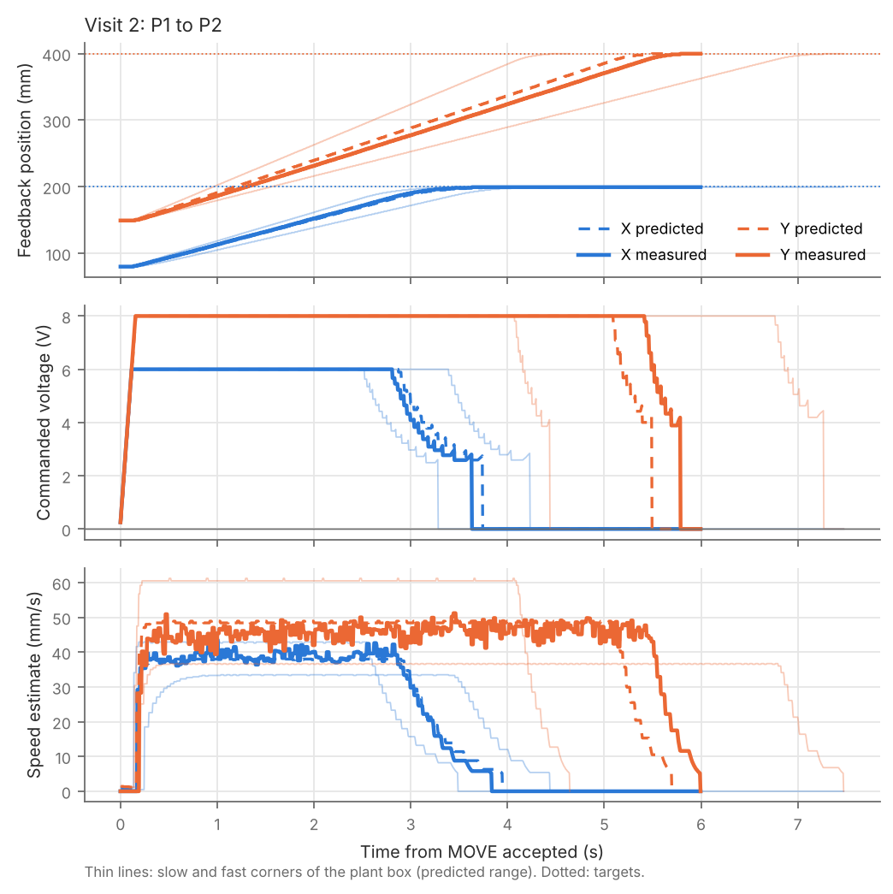
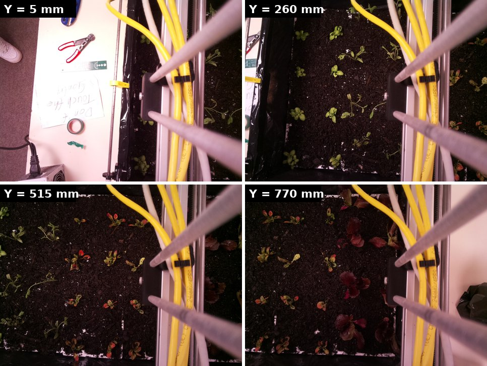
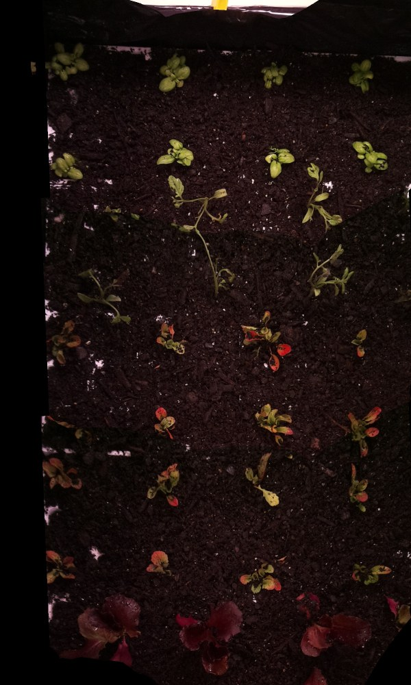

# Gantry robot for automatic weed removal

A low-cost, fixed three-axis gantry that photographs a crop bed, decides on the device which plants are weeds,
and sprays water at each weed. Built for a final-year Electrical and Computer Engineering research project
(EEE4022S) at the University of Cape Town. This repository holds the operator software, the ESP32-C3 motion
firmware and the simulations. Hardware: Raspberry Pi Zero W, ESP32-C3, 5 MP camera, a bed of 840 x 480 mm, parts budget R2000.

<p align="center"></p>

## How it works



- **Pi Zero W** runs the terminal UI, the capture and detection pipeline (offline on captured images, no cloud) and the spray jobs.
- **ESP32-C3** runs the three position controllers, homing, a noise filter on the position sensors, stall and timeout detection, and a link watchdog.
- **Safety:** the Pi forwards limit-switch states to the ESP32 every 50 ms. If they stop for 0.5 s, all motion stops.

## Design choices

| Decision | Why |
|---|---|
| One Y gearmotor drives both rails through a cross-shaft | Removes the problem of synchronising two motors electronically |
| Slotted optical sensors for position feedback | A time-of-flight sensor read 102 mm where a ruler read 760 mm, because its cone picked up the frame |
| Inference on the Pi Zero, not in the cloud | The system must work offline. ARMv6 has no PyTorch or ONNX Runtime builds, so models run as ONNX through OpenCV's DNN module |
| Spray-grid metric for detection | The nozzle fires over a cell and does not count plants, so instance IoU answers the wrong question |
| Controller gains derived from identified plants | Each axis was identified from step tests, then checked in simulation over its uncertainty range before it ran on the hardware |

<p align="center">


</p>

## Findings

All figures are from the project report (27 October 2026). The detection numbers use the public CWFID dataset, not the planted crops.

| Area | Result |
|---|---|
| Axis control | 245 closed-loop moves all ended within one sensor count (1.066 mm on X and Y, 0.267 mm on Z) |
| Settling time | Worst 1.86 s (X, 50 mm), 1.36 s (Y, 50 mm), 1.18 s (Z, 5 mm), against a 3 s limit |
| Overshoot | 0.10 mm worst, and the drive never reversed |
| Model fit | All 16 traced grid moves settled inside the range predicted from the identified plant |
| Positioning | Repeats within 1 mm. Within 14 mm of the command after fitting out the rotation of a hand-drawn grid (a bound, not a precise measurement). The requirement is 20 mm |
| Traverse | About 20 s per metre against 30 s required |
| Segmentation | Per-image Otsu threshold on excess green: mean IoU 0.883 over 21 CWFID images. A fixed threshold scored 0.40 on the first image against 0.86 for Otsu |
| On-device speed | Pi Zero W, one core: segmentation 4.3 s per image, YOLOv8n at 320 px 24.1 s |
| Detection metric | Spray-grid F1 0.908 for segmentation against 0.654 for YOLOv8n. Matched box by box, the order reverses |

<p align="center"></p>

*A traced X and Y move: measured (solid) against the prediction for the identified plant (dashed) and its slow and fast corners (thin).*

<p align="center">


</p>

*Left: four raw frames taken as the camera bridge moves along Y (5, 260, 515 and 770 mm). Right: the same frames stitched into one image. Together they cover 97.8% of the visible bed, with seams under 0.2 mm.*

### Limits of these results

- The 15-point laser positioning test was not run. The 14 mm figure comes from six grid readings with about 5 mm resolution.
- The Z carriage oscillation now dies out in under 1 s (about 3 s before the redesign). Its amplitude was not measured.
- The classifier was not trained on the planted crops at the time of the report, so no weed-versus-crop accuracy is claimed for the bed.
- The ROS 2 Gazebo control path is wired but was not run as a test for the final design.

## Recommendations

1. Train and score the classifier on labelled photographs of the real bed, and report precision, recall and the crop false-treatment rate there.
2. Classify only at planted positions. At 15 to 20 candidates per image the Pi's time is projected at about 14 to 17 s, against 35 s on average for classifying every blob.
3. Judge detection on the spray-grid metric, because the machine fires over cells.
4. Add light or longer exposure for dark red lettuce, which has the same colour as the soil, and avoid stitched images for labelling because tall plants shift with parallax.
5. Calibrate the nozzle-to-camera offset with the laser test, and run the structural checks that were not done for the X axis, Z axis and frame.

## Repository layout

| Path | Holds |
|---|---|
| `gantry-cli/` | Terminal UI and Pi-side software (Python, curses), 59 headless tests |
| `gantry-cli/firmware/gantry_fw/` | ESP32-C3 motion firmware (Arduino, v2.5) |
| `gantry-cli/firmware/sim/` | Host build of the firmware (C++) for unit and end-to-end tests without hardware |
| `simulation/controller-design/` | Batch simulator and design notes for the axis controllers over the plant uncertainty |
| `simulation/ros2-digital-twin/` | ROS 2 Jazzy URDF model of the gantry, RViz and Gazebo launch files |
| `docs/images/` | Photographs and figures used above |

## Try it without hardware

```sh
cd gantry-cli
pip install -r requirements.txt
cp gantry.example.json gantry.json
python3 gantry.py --sim                  # fake ESP32, switches and camera, in a 100x30 terminal
python3 -m unittest -v test_gantry       # 59 tests
firmware/sim/build.sh && firmware/sim/fwsim unit && python3 -m unittest -v test_e2e   # firmware and end to end
```

See [`gantry-cli/README.md`](gantry-cli/README.md) for wiring, firmware flashing and the Pi setup.

## Licence

MIT. See [LICENSE](LICENSE).
